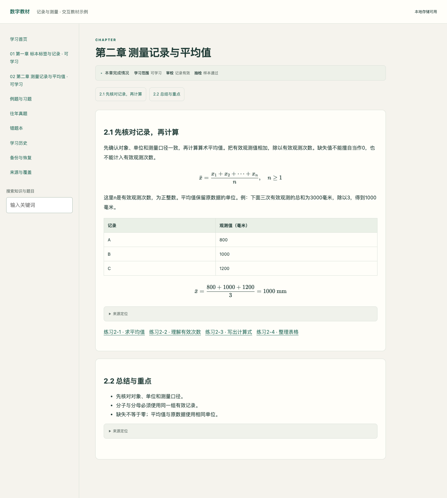
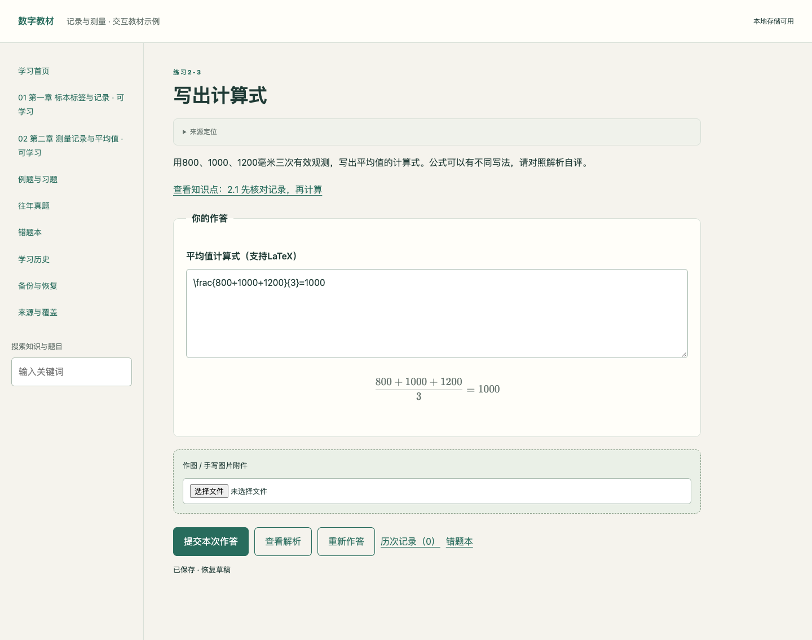
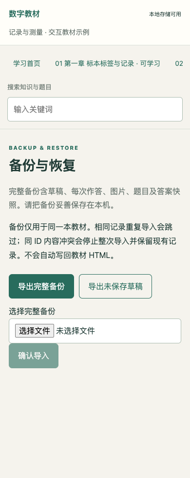

# 数字教材转换 · digital-textbook-html

将教材，或教材与课件、提纲、习题解析、真题的组合，制作成一个可离线阅读、作答并保存学习记录的交互 HTML。

**这是跨平台 Agent Skill，不限于 Codex。** 同一套规则、构建器与学习组件可安装到支持 [Agent Skills](https://agentskills.io/specification) 的 AI 助手。Claude Code、Cursor、GitHub Copilot CLI、Gemini CLI 和 Codex 的接入方式见下表。`agents/openai.yaml` 只是可选的 Codex 界面信息，不要求使用 OpenAI 模型或 API。

“支持安装插件”不等于“支持这个技能格式”。AI 还要获准读取资料、写文件、执行 Python/Node、查看原页并检查浏览器。只有聊天功能，或仅支持 MCP/其他专有插件格式的产品，不能仅上传本包就完成转换；需要相应执行环境或另外开发适配。**打开 HTML 模板也不会自动识别教材。** 教材理解、来源匹配、答案推导与语义核查由调用技能的模型完成。

## 先看成品

[下载可离线试用的自编示例 HTML](https://github.com/zjyu1712-zjy/digital-textbook-html/releases/download/v1.4.0/demo-general.html)，保存后用浏览器打开。示例包含两章、六道题，可体验资料讲解与融合、数值和公式等输入、历次作答、错题复习、章级状态、备份下载与恢复；没有预置用户学习记录。

| 章节阅读（宽屏） | 公式作答（宽屏） | 备份与恢复（390px） |
| --- | --- | --- |
|  |  |  |

这是自编节选，不是完整出版教材，也不代表所有学科已完成验证。截图与本轮实际验证条件、原文及重建方法见 [示例说明](examples/README.md)。

## 安装与调用

两种方式任选其一。使用生成后的 HTML 不需要 Python、Node 或安装技能。

**方式一：直接下载技能包。** 从 [GitHub Releases](https://github.com/zjyu1712-zjy/digital-textbook-html/releases/tag/v1.4.0) 下载 `digital-textbook-html-1.4.0.zip`，保留解压后的完整目录，放入自己的 AI 助手技能目录。此安装方式不需要 Node。各平台目录见 [跨平台说明](references/platform-compatibility.md)。已有同名技能先备份个人修改。

**方式二：使用安装工具。** 先查看 Node 版本，达到安装器要求后，在希望使用技能的项目目录运行：

```sh
node -v  # skills CLI 要求 Node.js 22.20+
npx skills add zjyu1712-zjy/digital-textbook-html --skill digital-textbook-html
```

[skills CLI](https://github.com/vercel-labs/skills) 默认安装到当前项目；跨项目使用加 `--global`。如果 Node 版本较低或安装器无法运行，可以直接使用方式一，不必为了安装技能强制升级运行环境。生成端与浏览器验收的要求见下方版本矩阵。

可明确指定目标，例如：

```sh
npx skills add zjyu1712-zjy/digital-textbook-html --skill digital-textbook-html --agent claude-code
```

| 你的 AI | `--agent` 参数 | 安装后如何调用 |
| --- | --- | --- |
| Claude Code | `claude-code` | `/digital-textbook-html` 或自然语言指定 |
| Cursor Agent | `cursor` | 输入 `/`，选择 `digital-textbook-html` |
| GitHub Copilot CLI | `github-copilot` | `/digital-textbook-html`；可用 `/skills info digital-textbook-html` 查看 |
| Gemini CLI | `gemini-cli` | `/skills list` 查看，再用自然语言要求使用该技能 |
| Codex | `codex` | `$digital-textbook-html` 或自然语言指定 |

安装后可以直接说：

> 使用 digital-textbook-html 数字教材转换技能，按其中的学习习惯，把我上传的教材转换成完整交互 HTML。先盘点资料与运行环境，再转换、核查和修复，最后交付一个可离线打开的 HTML。

只有一本教材也能开始；没有真题不会生成假真题。分批上传时先说“还没发齐，先不要转换”，发齐后再开始。若宿主没有识别技能，先检查其技能列表、安装目录与权限，不把“复制了文件”等同于“模型已调用”。

技能包是标准 Agent Skills 目录，不是任意平台通用的插件商店包；只在目标产品支持此格式时上传。不要只复制 `SKILL.md`，需保留 scripts、references、assets、tests 和 examples。

## 能力与质量

- **资料组织：**教材主导、教师课件主导、提纲主导、组合资料；主次和用途按使用者要求确定，不因提供PPT就默认课件主导。
- **内容融合：**纳入学习的资料须实际融入知识点讲解、总结和重点呈现；后续补资料同步更新受影响内容，不能仅附上文件或原页。明确仅作存档或对照的资料按指定用途保留。
- **任务资料约定：**逐份记录用途、适用章节和用户要求；混合资料未定主次时不按PPT类型猜测。
- **融合与审校证据：**记录知识点实际进入讲解、总结和重点的位置；审校绑定当时内容及相关来源，变化后提示复核。脚本检查绑定时效，不自动判断知识正确。
- **学科策略：**数学与推导、理论与论述、模型与图形、会计业务与表格、数据与统计、通用教材，可组合使用。
- **学习页面：**独立章节、搜索、知识点与题目跳转、原例题/原练习、真题整卷入口、隐藏答案及来源标记。
- **作答与记录：**文字、填空、数值、选择、多选、公式、矩阵、分录、表格；图片附件、草稿自动保存、追加历次作答、完整备份导入导出。
- **错题复习：**明确的客观错答和手动标记进入错题本；按章筛选、重做、标记掌握并导出含图片的记录。不同题目/答案版本分别保留，正确重做不删除过去的错误。
- **独立抽检：**按原资料清单抽取跨章节、来源与类型的样本，先独立读原文，再检查生成讲解、总结与重点。保存原文观察和逐样本依据；内容变化后旧结论过期，抽样通过不冒充全文通过。
- **章级状态：**分别显示内容整理、审校、抽检、离线功能和视觉检查的范围；没有实际证据时显示未验证。首页显示本次可学习章数、从首章开始的连续范围和其他可用段，缺章保留具体待补说明。
- **体积管理：**构建报告正文数据、图片、字体和脚本的实际占用；默认60MiB提醒、100MiB阻断。可选图片工具只生成副本，保留原件和摘要，使用前须核对可读性。

原题、原答案与 AI 参考答案分别标记。缺页、模糊题设、版本冲突和无法确认的答案须明确报告；不能用摘要、原创自测或编造内容代替教材。更换 AI 不改变这些标准，也不保证不同模型的教学质量相同。

## 运行环境

| 用途 | 所需环境 |
| --- | --- |
| 下载 ZIP、手动安装 | 不要求 Node |
| 使用 skills CLI 安装 | Node 22.20+（外部安装器要求） |
| 构建无公式内容 | Python 3.9+ |
| 构建含公式内容 | Python 3.9+、Node；推荐已验证的 Node 24 |
| 浏览器验收 | Node 20+、Playwright、可用的 Chromium 系浏览器 |
| 打开生成的 HTML | 浏览器，无需安装上述生成工具 |

原资料读取、PDF/扫描件识别和查看原页由宿主提供，本仓库不内置万能 OCR，也不自动购买或调用第三方模型。

在任意工作目录，以技能的实际绝对路径检测环境：

```sh
python3 /path/to/digital-textbook-html/scripts/doctor.py --workspace /path/to/textbook-work --out /path/to/textbook-work/checks/environment.json
```

检测器不安装软件、不改全局配置、不联网。`buildReady` 只表示基础构建环境就绪；原页识别、语义核查、真实浏览器存储及视觉检查仍须实际执行，不能用环境检测代替验收。`NODE_BINARY`、`PLAYWRIGHT_MODULE`、`BROWSER_EXECUTABLE` 可以指向宿主已有工具。

**最终学习 HTML 无需上述依赖：**正文、图片、数学资源、样式与脚本均内嵌，可在浏览器离线打开。记录存于当前浏览器，不会写回 HTML；换浏览器、设备或文件入口，以及清理浏览器前，应导出完整备份。存储只读时仍可查看和导出已有记录，新作答不能保存或提交。不同浏览器的 file:// 隔离方式可能不同，相同书ID不保证跨文件共享；实测范围见[示例说明](examples/README.md)。

## 验证与维护

[1.1.0 验收记录](references/release-1.1.0.md) 区分格式核实、安装测试、模型实际调用与成品浏览器测试；不能把安装器成功写成所有 AI 都已完成真实教材转换。

入口是 [SKILL.md](SKILL.md)，偏好是 [references/preferences.md](references/preferences.md)，通用质量与内容结构分别在 [质量契约](references/quality.md)、[数据契约](references/schema.md)。安装目录作为只读资源；需要定制样式时复制到工作区后修改副本，不影响其他项目。

本仓库只包含方法、组件、工具与自编测试资料，不含五门课程私有教材、课件、真实作答记录、密钥或网页部署工程。KaTeX 与字体保留 [第三方许可证](assets/vendor/KaTeX-LICENSE.txt)。1.2.0新制作采用内容结构v2；旧v1仍可读取和构建，但未绑定的旧审校记录明确标为待核查。升级说明见 [任务资料约定与审校时效](references/task-contract-and-review.md)。学习存储键、题目 ID 和备份格式不变。
